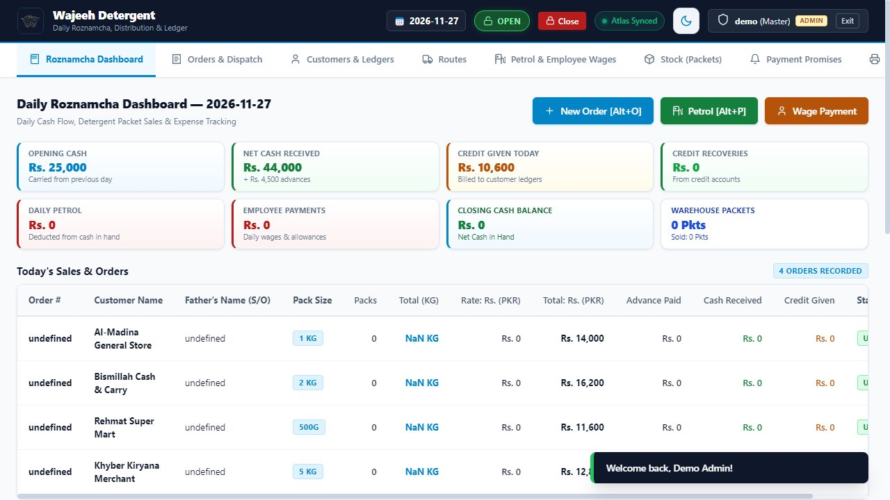
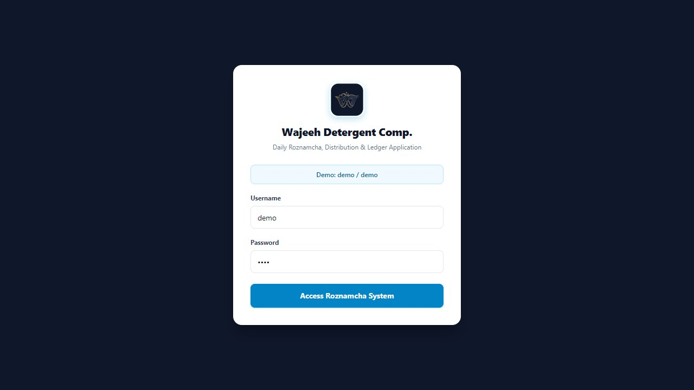
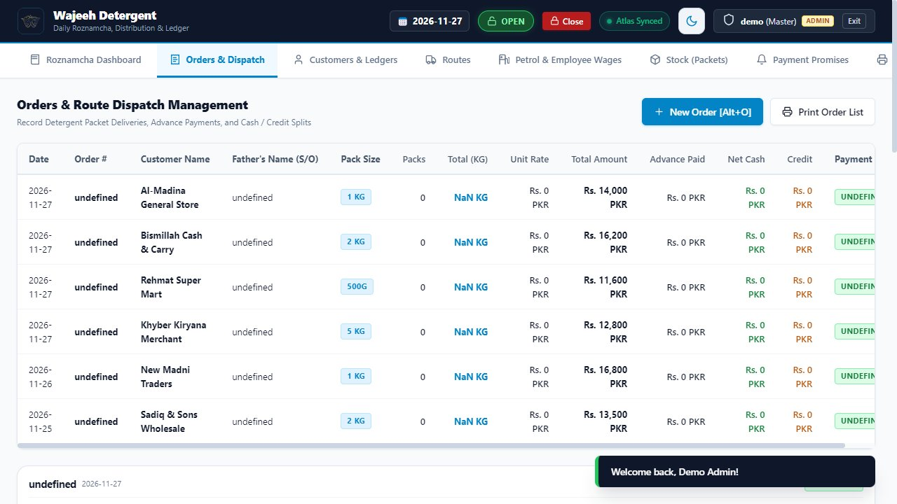
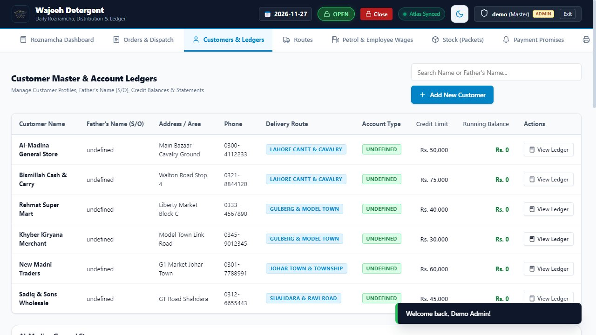
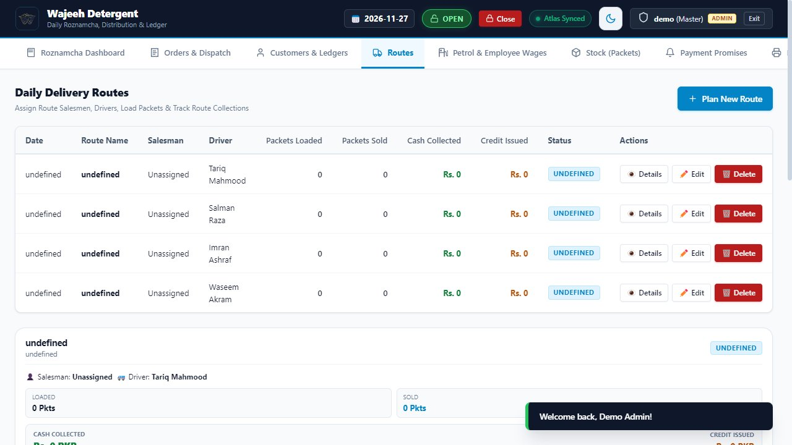
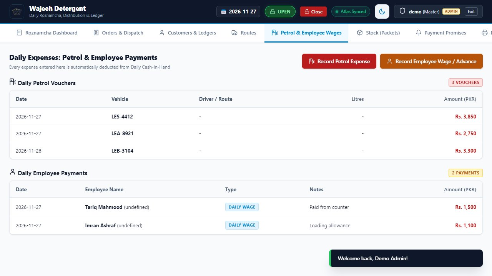
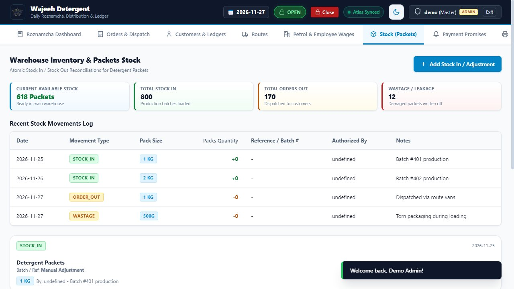
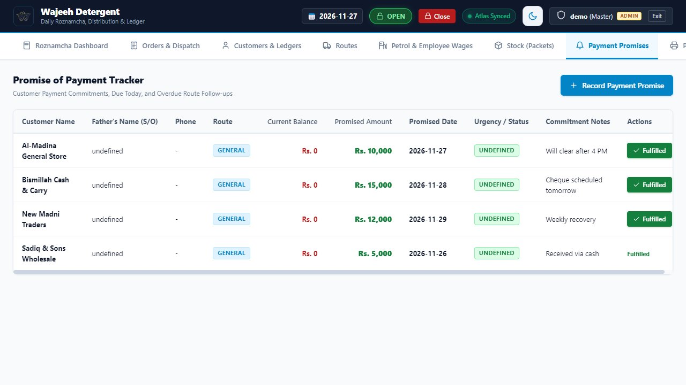
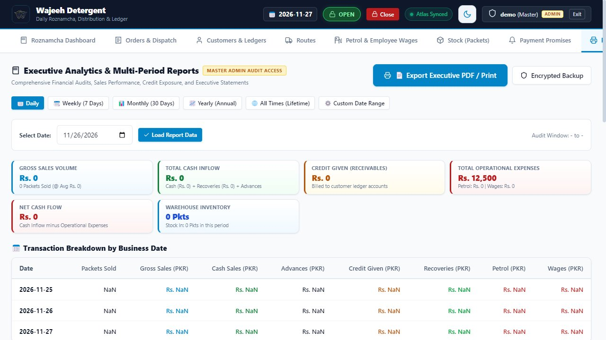
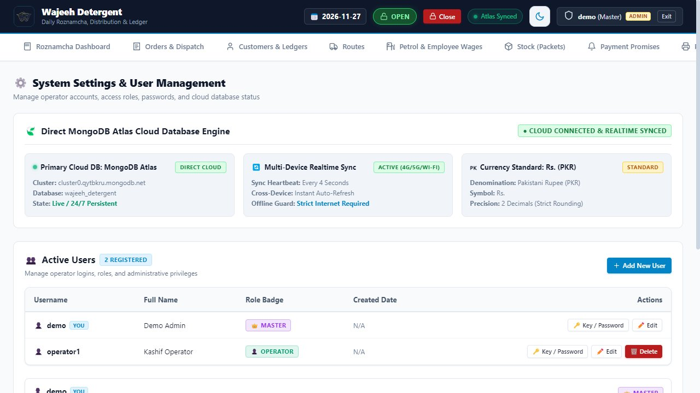

# Wajih Detergent Demo — Daily Roznamcha, Distribution & Ledger Suite

**Serverless Demo Edition (v1.0.0) • Demo Account: username `demo` / password `demo`**

[-Latest_Release-2ea44f?style=for-the-badge&logo=github)](https://github.com/rajpoot-8047/Wajih-Detergent-Demo/releases/latest)

 

---

## Demo Credentials (100% Serverless)

This release runs completely **offline / serverless** using an inbuilt localStorage relational database pre-seeded with sample daily roznamcha entries, orders, customers, routes, expenses, stock, promises, and reports:

- **Demo Account:** username `demo` / password `demo`

---

## Visual Gallery

| Login Screen | Daily Roznamcha | Orders |
| :---: | :---: | :---: |
|  |  |  |
| **Customers** | **Routes** | **Expenses** |
|  |  |  |
| **Stock** | **Promises** | **Reports** |
|  |  |  |
| **Settings** | | |
|  | | |

---

## Platform Downloads

| Platform | Format | Link |
| :--- | :--- | :--- |
| **Windows (x64)** | Installer (.exe) | [Download from GitHub Releases](https://github.com/rajpoot-8047/Wajih-Detergent-Demo/releases/latest) |
| **Android** | Package (.apk) | [Download from GitHub Releases](https://github.com/rajpoot-8047/Wajih-Detergent-Demo/releases/latest) |

---

## Private-Source Security Notice

> **Note:** This repository is a **source-code-free public showcase**. Application source code, backend services, and database schemas are kept private. Compiled serverless Demo installers are distributed exclusively via [GitHub Releases](https://github.com/rajpoot-8047/Wajih-Detergent-Demo/releases/latest).
